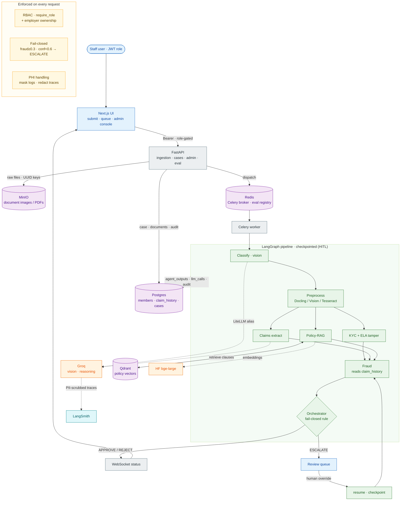

# PolicyFlow AI · 健康险理赔审核助手

PolicyFlow AI 用 LangGraph 编排健康险理赔审核。FastAPI 接收理赔材料后，多个节点分别完成文档分类、字段抽取、身份核验、条款检索和风险评估。审核人员可以查看条款引用和风险依据，并接手需要人工复核的案件。

本仓库由 `204404837a` 维护，基于 Aswathy Nair 的 ClaimShield AI 改版。原作者署名及 MIT 许可保留在仓库中。[上游提交](https://github.com/abnair24/ClaimShield-AI/commit/37c812cbc70099b39aff06c626879f3be0053ed5) · [MIT 许可证](./LICENSE)

---

## 🚀 Highlights

| Capability | What it does |
|---|---|
| **Multi-agent LangGraph pipeline** | Classify → Preprocess → parallel **KYC ∥ Claims ∥ Policy-RAG** → Fraud → Orchestrator, as a checkpointed graph. Parallel agents fan out; a reducer accumulates their state deltas before the decision. |
| **Fail-closed decision rule** | Pure, non-LLM Orchestrator: `fraud_score ≥ 0.3` **or** any agent `confidence < 0.6` → **ESCALATE**; KYC failure (expired / tampered / name-mismatch) or uncovered procedure → cannot APPROVE. Boundaries pinned by a truth-table test. |
| **Policy coverage via RAG** | bge-large clause chunks in Qdrant; a covered decision **must** cite a retrieved clause — no clause, not "covered." |
| **Fraud scoring on real history** | Signals over `claim_history`: duplicate_claim, readmission_30d, date_conflict, proc_diag_mismatch, structuring, name_mismatch — every anomaly recorded even when the decision differs. |
| **KYC + ELA tamper detection** | Member lookup + error-level-analysis image forensics on ID documents; tamper/expiry/name-mismatch block approval. |
| **RBAC as a hard gate** | JWT auth; `require_role(*roles)` on every route. Three roles — **EMPLOYER / REVIEWER / ADMIN** — with employer **ownership scoping** (`submitted_by = me`), enforced server-side. |
| **Human-in-the-loop** | ESCALATE interrupts at a checkpoint; `POST /cases/{id}/override` resumes the graph thread, locks the case, and writes an audited row (append after lock → `409`). |
| **Live eval dashboard** | Two run-groups (pipeline / retrieval) drive the same scorer over the dataset from the admin console — one run at a time (`409` guard), refresh-safe (`/api/eval/status`), honest about empty/rate-limited runs. |
| **PHI-safe observability** | Structured JSON logs with a central **PII-redaction filter**; per-call `llm_calls` token/latency rows; LangSmith traces scrubbed of prompt text and image bytes. |
| **Provider-agnostic LLM** | App code only ever calls logical aliases (`vision` / `reasoning` / `embeddings`) through `llm/client.py`; swapping Groq ↔ another provider is a config change, not a code change. |

---

## 🗺️ Architecture



- **Ingestion (per submission):** employer uploads 1..N docs → API validates (magic-byte / size / type), stores raw files in MinIO under UUID keys, creates the `case` + `documents` in Postgres, and enqueues a Celery job.
- **Pipeline (worker):** the checkpointed LangGraph runs Classify → Preprocess → parallel KYC ∥ Claims ∥ Policy-RAG → Fraud → Orchestrator; every model call goes through a LiteLLM alias, Policy-RAG queries Qdrant, and all outputs + audit land in Postgres.
- **Three-layer rule:** `api → worker/graph → agents → services → adapters (llm / storage / db)`. A layer only calls the next one down; vendor SDKs live only in adapters.

Full pipeline, contracts, and Pydantic boundaries: **[docs/ARCHITECTURE.md](./docs/ARCHITECTURE.md)** · **[docs/HLD.md](./docs/HLD.md)** · **[docs/LLD.md](./docs/LLD.md)**.

---

## 🛠️ Tech stack

| Concern | Choice |
|---|---|
| API / async backend | FastAPI + Pydantic v2, JWT auth |
| Orchestration | LangGraph (StateGraph, Postgres checkpointer, `interrupt()` for HITL) |
| Task queue | Celery + Redis |
| LLM gateway | LiteLLM proxy → **Groq** — `qwen/qwen3.6-27b` (vision), `llama-3.3-70b-versatile` (reasoning) |
| Embeddings | Hugging Face `BAAI/bge-large-en-v1.5` (1024-d) |
| Vector store | Qdrant (policy clause chunks) |
| Doc parsing | Docling (PDF) · Vision LLM (image) · Tesseract (fallback) |
| Data / object / cache | Postgres (asyncpg) · MinIO (S3) · Redis |
| Frontend | Next.js 14 + TypeScript (3 role portals) |
| Evals | pytest + stdlib scorer (deterministic) · live harness over the dataset |
| Lint / types / pkg | ruff · mypy · uv |

---

## 快速启动

本地演示需要 Python 3.11 或更新版本和 Docker Compose。使用 Groq 和 Hugging Face 访问模型时，在 `.env` 中填写 `GROQ_API_KEY` 与 `HUGGINGFACE_API_KEY`。[Groq 控制台](https://console.groq.com) · [Hugging Face 令牌](https://huggingface.co/settings/tokens)

在仓库根目录运行以下 PowerShell 命令。四个生成脚本会在 `dataset/` 写入虚构投保人、样例材料和条款 PDF。

```powershell
python -m venv .venv
.\.venv\Scripts\python.exe -m pip install fpdf2 numpy Pillow
.\.venv\Scripts\python.exe -m scripts.generate_docs
.\.venv\Scripts\python.exe -m scripts.generate_gold_policy
.\.venv\Scripts\python.exe -m scripts.generate_silver_policy
.\.venv\Scripts\python.exe -m scripts.generate_unknown

Copy-Item .env.example .env
# 先在 .env 中填写模型密钥，再启动
docker compose up -d --build
docker compose exec api alembic upgrade head
docker compose exec api python -m app.db.seed
```

macOS 和 Linux 使用 `.venv/bin/python` 与 `cp` 运行同样的步骤。打开页面后，用 `ADMIN_USERNAME` 和 `ADMIN_PASSWORD` 登录，本地默认均为 `admin`。在管理页建立审核员和提交者账号，再上传 `dataset/policies/` 中的两份 PDF 并绑定 `GOLD` 和 `SILVER`，即可测试条款检索和理赔材料上传。

| Service | URL |
|---|---|
| Frontend (Next.js) | http://localhost:3000 |
| API (FastAPI) | http://localhost:8000 · docs at `/docs` · `/health` |
| MinIO console | http://localhost:19001 |
| Qdrant dashboard | http://localhost:16333/dashboard |
| LiteLLM proxy | http://localhost:4000/health |

```bash
docker compose ps                    # all services at a glance
docker compose logs -f api worker    # follow the pipeline path
docker compose down                  # stop
```

Full deploy + env table (JWT / admin / eval / pacing vars) and cloud notes: **[docs/DEPLOY.md](./docs/DEPLOY.md)**.

---

## 🔐 Roles & access (RBAC)

JWT auth (`/api/auth/login`); every route except login + `/health` requires `Authorization: Bearer <jwt>` and gates on one of three roles via `require_role`. Roles are **admin-assigned only** — there is no open self-registration.

| Role | Portal | Can |
|---|---|---|
| **EMPLOYER** | `/submit`, `/my-claims` | submit claim bundles; view **own** cases only (ownership-scoped) |
| **REVIEWER** | `/queue`, `/claims`, `/policies` | work the escalation queue, override cases, browse all claims, ingest policies |
| **ADMIN** | `/admin` | manage users + KYC members, ingest policies, reset claims, **live eval dashboard**, see everything |

**Try it:** as an **employer**, upload an ID + claim form + discharge summary on `/submit` → watch per-agent panels fill in live → a clean bundle APPROVEs, a tampered ID or fraud signal ESCALATEs to the reviewer `/queue`, where a human override resumes and locks the case.

---

## 🧭 Local access & operations

Component endpoints (default compose ports; **credentials live in `.env`** — never hard-code them):

| Component | URL / address | Auth |
|---|---|---|
| Frontend (UI) | http://localhost:3000 | Login (JWT); role-gated portals |
| API | http://localhost:8000/docs · `/health` | `Bearer <jwt>` (except `/api/auth/login`, `/health`) |
| MinIO console | http://localhost:19001 | `MINIO_ACCESS_KEY` / `MINIO_SECRET_KEY` (`.env`) |
| MinIO S3 API | http://localhost:19000 | `.env` (for `mc`/SDK) |
| Qdrant dashboard | http://localhost:16333/dashboard | none |
| LiteLLM proxy | http://localhost:4000/health · `/v1/models` | Bearer `LITELLM_MASTER_KEY` (`.env`) |
| Postgres | `localhost:5432` (DB client) | from `DATABASE_URL` (`.env`) |
| Redis | `localhost:6379` (`redis-cli`) | none |
| Worker | *(no port)* | Celery — inspect via logs/CLI |

> Host port clashes with another local stack? Drop a `docker-compose.override.yml` remapping the `ports:` of the affected services (compose auto-merges it) — no change to the tracked `docker-compose.yml`.

Logs & health checks (from repo root):

| Component | Tail logs | Health check |
|---|---|---|
| Frontend | `docker compose logs -f frontend` | `curl -I http://localhost:3000` |
| API | `docker compose logs -f api` | `curl http://localhost:8000/health` |
| Worker | `docker compose logs -f worker` | `docker compose exec worker celery -A app.worker.celery_app inspect ping` |
| LiteLLM | `docker compose logs -f litellm` | `curl http://localhost:4000/health -H "Authorization: Bearer $LITELLM_MASTER_KEY"` |
| Postgres | `docker compose logs -f postgres` | `docker compose exec postgres pg_isready -U "$POSTGRES_USER"` |
| Qdrant | `docker compose logs -f qdrant` | `curl http://localhost:16333/collections` |
| MinIO | `docker compose logs -f minio` | `curl http://localhost:19000/minio/health/live` |
| Redis | `docker compose logs -f redis` | `docker compose exec redis redis-cli ping` |

**Reset ingested claims** (keeps members/users/policy vectors — the state right after a fresh build):

```bash
docker compose exec api uv run python -m app.db.clear_cases
```

---

## 🔑 Evaluations

The offline runner is the source of truth; the admin **Evaluation** dashboard drives the same scorer live over the dataset.

```bash
# Score a captured run against dataset/metadata.json (deterministic, offline):
docker compose exec api uv run python -m eval.run_eval
# Regenerate the capture from the live pipeline over all 155 docs (needs keys):
docker compose exec api uv run python -m eval.run_eval --live
```

Per-stage metrics (classification / extraction / retrieval / KYC / fraud / decision) roll up into a rubric-weighted grade; **hard-gates Decision Correctness ≥ 60% and overall ≥ 70%**.

**From the Admin UI** (`/admin` → Evaluation) the same scorer runs live in the worker, in two groups that mirror the pipeline's coupling:
- **Run pipeline** — classification / extraction / decision / KYC / fraud (one graph pass; `Sample` limits the case count).
- **Run retrieval** — the standalone RAG spot-check (cheap, no vision calls).

Operational guarantees: **one run at a time** (a second trigger → `409`), **refresh-safe** (a reloaded page resumes an in-flight run via `/api/eval/status`), and **honest about empties** — a run whose cases all fail (e.g. rate-limited) reports `captured_cases=0` / `skipped` and reads as broken instead of a phantom pass.

> **Free-tier note:** Groq's free tier has per-minute and per-day token caps; image-heavy vision calls can hit them. Batch eval is throttled (`LLM_MIN_INTERVAL_S`, ~30s on the worker) to stay under the limit, and `Retry-After` is honored automatically — a full 155-doc run is slow, so **sample a few cases first**. See **[docs/EVAL_PLAN.md](./docs/EVAL_PLAN.md)**.

---

## 🔍 Observability

PHI-safe by design — raw member IDs, DOB, SSN, ICD/CPT, amounts, and image bytes are **never** logged; only masked forms, IDs, counts, scores, and durations.

- **Structured JSON logs** with a central redaction filter (`core/logging.py`).
- **Per-call LLM accounting** — every gateway call writes an `llm_calls` row (model, prompt/completion tokens, latency); the client also captures rate-limit detail so 429s are diagnosable, not opaque.
- **LangSmith tracing** (optional, `LANGSMITH_API_KEY`) — per-agent token/latency, with prompt text and ID images scrubbed before any callback fires.
- **Full audit trail** — every decision and override persists `decision`, `confidence`, `justification`, `agent_summaries`, and an immutable `audit_events` row.

---

## 🧪 Quality

CI order (fail-closed): **security red-team → unit → integration → eval**. The security track runs first and fails the build on any critical. See **[docs/SECURITY_REDTEAM.md](./docs/SECURITY_REDTEAM.md)** and **[docs/EVAL_PLAN.md](./docs/EVAL_PLAN.md)**.

```bash
docker compose exec api uv run ruff check . && docker compose exec api uv run pytest
```
---
