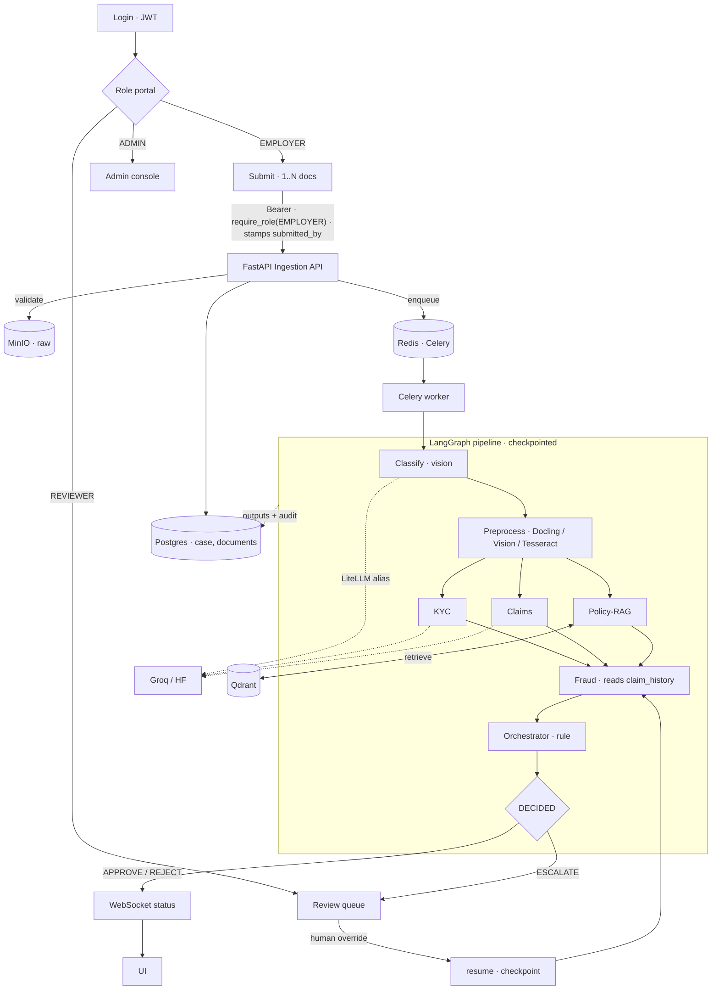

# ARCHITECTURE.md — Agent-Facing Distillation

> **Distillation, not source of truth.** Full designs live in [HLD.md](./HLD.md), [LLD.md](./LLD.md), [DATABASE_SCHEMA.md](./DATABASE_SCHEMA.md). This file gives coding sessions the **layers, call-direction rule, folder map, and boundary/adapter patterns** to obey. When something changes, it changes in the Stage‑1 doc; this file points there.

## 1. Flow



Fan-out `[KYC ∥ Claims ∥ Policy-RAG]` runs in parallel; a reducer accumulates their state deltas before Fraud. See [HLD.md §1](./HLD.md) (topology), [§2](./HLD.md) (state machine), [§6](./HLD.md) (sequence).

## 2. Layers & the one-way call rule
```
api/            → worker/ (celery) → agents/ → services/ → adapters: llm/ , ingestion/ , db/
```
**A layer may only call the next one down.** `agents/` never import `api/`; `services/` never import `agents/`; DB/LLM/object-store access **only** through adapters. Enforced by `.claude/rules/code-quality.md` §4. Rationale & patterns: [LLD.md §7–8](./LLD.md).

## 3. Folder map (authoritative: [LLD.md §1](./LLD.md))
`backend/app/{core,db,schemas,llm,ingestion,agents,services,api,worker}` · `eval/` · `frontend/` · `scripts/` (existing generators) · `dataset/` (generated) · `docs/` · `discussions/`.

## 4. Where validation & boundaries live
- **Every boundary is a Pydantic v2 model** — API request/response, agent I/O (`*Output`), `DocumentContent`. Contracts: [LLD.md §3](./LLD.md).
- **Ingress validation** (magic-byte, size, type) in `core/security.py` at the API edge.
- **Decision thresholds** (`0.3`, `0.6`, `≤3`, `top_k`) in one constants module — never inline.

## 5. Adapter pattern (provider-agnosticism)
- **LLM:** app code calls `llm/client.py` with an alias (`vision`/`reasoning`/`embeddings`). Only `llm/` + `litellm-config.yaml` know providers/models. Swap Groq↔other = config, not code. ([LLD.md §2](./LLD.md))
- **Storage:** `ingestion/storage.py` wraps MinIO. **DB:** `db/` (async SQLAlchemy) + repository-style services. **Vector:** `services/rag_service.py` wraps Qdrant (sole reader/writer).

## 6. Logging & auth model
- **Logging:** structured JSON (`core/logging.py`) with a central **PII redaction filter**; `llm_calls` rows capture token/latency; LangSmith traces are PII-scrubbed. Rules: `.claude/rules/data-handling.md`.
- **Auth & RBAC:** JWT (bcrypt + HS256) auth gateway in front of the API; `api/deps.require_role(*roles)` gates every route by one of three roles — **ADMIN / REVIEWER / EMPLOYER** — with employer **ownership scoping** (`submitted_by = me`). The UI is three role-gated portals; the token (from `/api/auth/login`) is attached as a Bearer header on every call. All data treated as PHI/PII. Boundaries: [GUARDRAILS.md](./GUARDRAILS.md), [DATA_HANDLING.md](./DATA_HANDLING.md) (authz section).

## 7. Failure & HITL
Retry ≤3 on extraction/validation failure → else ESCALATE; ESCALATE interrupts at a checkpoint → human override resumes. Append re-runs Fraud+Orchestrator; human-finalized cases lock (`409`). See [HLD.md §2.1](./HLD.md), [LLD.md §8](./LLD.md).
