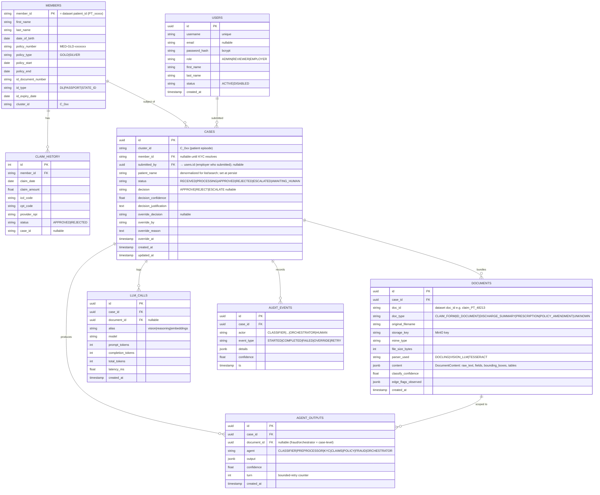

# PolicyFlow AI — Database Schema
### Postgres (relational) · Qdrant (vector) · Redis (cache/broker) · MinIO (object)
**Status:** Approved-for-build · **Last updated:** 2026-08-02 · Prev: [HLD.md](./HLD.md) · Next: [LLD.md](./LLD.md)

---

## 1. ER Diagram (Postgres)

---

## 2. Tables (DDL summary)

### `users` — application login accounts (RBAC)
- `id` (uuid PK), `username` (unique), `email`, `password_hash` (bcrypt), `role` (`ADMIN|REVIEWER|EMPLOYER`), `first_name`, `last_name`, `status` (`ACTIVE|DISABLED`), `created_at`.
- Distinct from `members`: a **user** is a login account; a **member** is a KYC patient record. `cases.submitted_by` → `users.id` scopes employer visibility.
- First admin is bootstrapped idempotently by `db/seed.ensure_admin()` from `ADMIN_USERNAME`/`ADMIN_PASSWORD` (env). Additional users are created by an admin (`POST /api/admin/users`); roles are never self-chosen.

### `members` — KYC source of truth
Seeded from the dataset (see §5). PK `member_id` = dataset `patient_id`.
- Indexes: PK(`member_id`), idx(`policy_number`), idx(`cluster_id`).
- Note: for `name_mismatch` fraud, `members` stores the **true** name; the ID document shows the mismatched name → KYC flags it.

### `claim_history` — Fraud baseline (long-term memory)
Pre-seeded with prior claims per member (enables `readmission_30d`, frequency, provider-pattern, `duplicate_claim` detection). Rows are also **appended** as new claims are approved during a run.
- Indexes: PK(`id`), idx(`member_id`), idx(`member_id`,`claim_date`), idx(`cpt_code`).

### `cases` — one per patient-episode submission (bundle)
- `status` lifecycle: `RECEIVED → PROCESSING → (APPROVED|REJECTED|ESCALATED)`; `ESCALATED`/`AWAITING_HUMAN` await override.
- Override columns capture the HITL action; original `decision` is preserved for audit.
- **Locked = `override_decision IS NOT NULL`** (human-finalized). Appending documents to a locked case → API `409`. Auto-decided (non-overridden) cases accept appends and re-decide (HLD §2.1).
- Indexes: PK(`id`), idx(`status`), idx(`cluster_id`), idx(`created_at`).

### `documents` — N docs per case
- `content` (JSONB) is the normalized `DocumentContent` (`raw_text`, `fields`, `bounding_boxes`, `tables`).
- Indexes: PK(`id`), idx(`case_id`), unique(`storage_key`), idx(`doc_type`).

### `agent_outputs` — normalized, one row per agent (per doc or per case)
- Normalized (one row per agent) for extensibility, per-agent eval, and a clean audit trail.
- `turn` supports bounded-retry (≤3) tracking.
- Indexes: PK(`id`), idx(`case_id`), idx(`case_id`,`agent`).

### `llm_calls` — observability (LiteLLM per-call)
- Powers cost/latency dashboards + feeds calibration analysis.
- Indexes: PK(`id`), idx(`case_id`).

### `audit_events` — immutable timestamped trace
- Every agent START/COMPLETE/FAIL/RETRY and every HUMAN OVERRIDE.
- Indexes: PK(`id`), idx(`case_id`,`ts`).

### Enums
`DocumentType`, `Decision(APPROVE|REJECT|ESCALATE)`, `RiskLevel(LOW|MEDIUM|HIGH)`, `CaseStatus`, `AgentName`, `ParserUsed`, `PolicyType(GOLD|SILVER)`, `Role(ADMIN|REVIEWER|EMPLOYER)`, `UserStatus(ACTIVE|DISABLED)`.

---

## 3. Qdrant — `policy_documents` collection
| Property | Value |
|---|---|
| Vector size | 1024 (bge-large) |
| Distance | Cosine |
| Payload | `{ plan: GOLD|SILVER, section: str, section_id: str, clause_text: str, source_pdf: str, chunk_index: int }` |
| Sparse (hybrid) | keyword/BM25 index on `clause_text` |
| Point id | deterministic hash(`plan`+`section_id`+`chunk_index`) for idempotent upsert |

---

## 4. Redis & MinIO
- **Redis:** Celery broker/result backend (`db 0`); LiteLLM response cache (`db 1`, TTL configurable); eval **active-run registry** key `policyflow:eval:active_run` (`{task_id, scope}`, short TTL — one live eval at a time, resume-on-refresh). No durable business state.
- **MinIO:** bucket `policyflow`; object key `raw/{case_id}/{doc_id}.{ext}`. Served read-only via API with `Content-Disposition: inline`, `X-Content-Type-Options: nosniff`.
- **LangGraph checkpointer:** Postgres saver in schema `langgraph` (separate from business tables); one thread per `case_id` for HITL resume.

---

## 5. Seeding Strategy (P0 — fixes the KYC-mismatch bug)

KYC must validate against member records whose **field formats match the generated documents**. Therefore the seed is **derived from the dataset**, never invented:

1. Preferred: add one additive line to `scripts/generate_docs.py` to emit `dataset/members.json` from the `clusters` list (fields: `patient_id`, `name`, `dob`, `policy`, `policy_type`, `id_type`, `id_expiry`, `cluster_id`, and the `edge_flags` that affect expiry). *No rewrite — a single `json.dump`.*
2. `db/seed.py` loads `dataset/members.json` → `members` table, and synthesizes `claim_history` (prior claims per member; inject the specific rows needed for `readmission_30d` / `duplicate_claim` clusters so those fraud signals are detectable).
3. `member_id` (= `patient_id`) and `policy_number` (= `policy`) are stored **verbatim** from the dataset so extracted document fields join cleanly.

> Ground-truth `metadata.json` fields available per doc: `doc_id, category, case_cluster_id, fraud_label, fraud_reason, edge_flags, patient_id, policy_number, blur_simulated, file_path`. Richer identity fields (name/dob/id_expiry) come from the `members.json` export in step 1.
