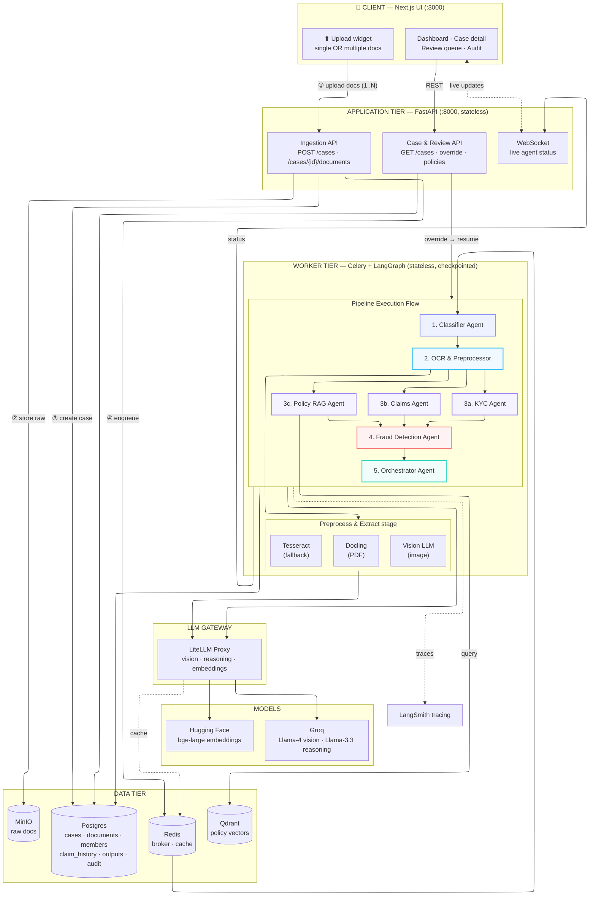
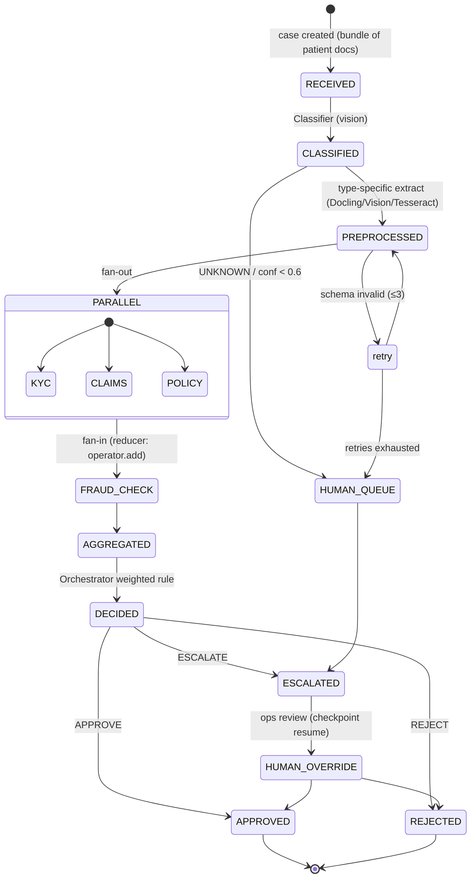
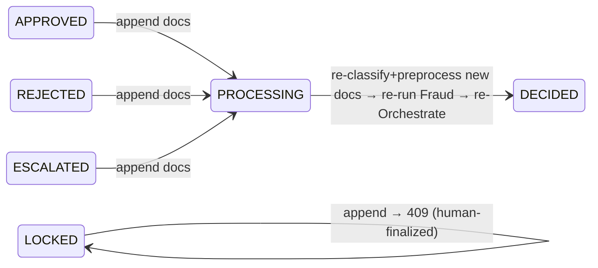
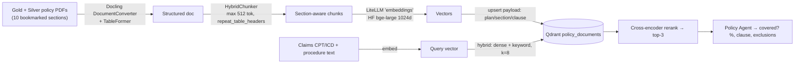
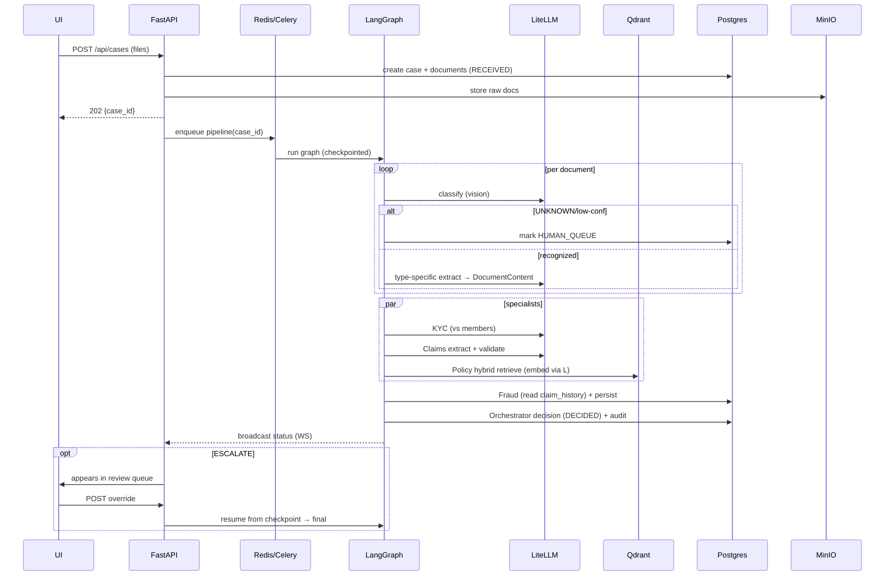

# PolicyFlow AI — High-Level Design & System Architecture (HLD)
### PolicyFlow Demo Multi-Agent Document Intake Platform
**Status:** Approved-for-build · **Last updated:** 2026-08-02 · Prev: [PRD.md](./PRD.md) · Next: [DATABASE_SCHEMA.md](./DATABASE_SCHEMA.md)

> Cloud-ready posture (locked).

---

## 1. System Topology

**Reading the diagram — the ingestion path is the numbered flow ①→④:** a user uploads 1..N documents from the **UI upload widget** → the **Ingestion API** stores raw files in MinIO, creates the case in Postgres, and enqueues the job → the **Worker** runs the LangGraph pipeline. The **review/monitor path** is separate: the UI reads cases via the Case API and receives live agent status over WebSocket; a human **override** resumes the checkpointed pipeline.

**Notes:** the pipeline's "Preprocess & Extract" stage is distinct from document *ingestion* (the UI upload path). All LLM access flows through the **LiteLLM gateway** to Groq/HF; the **Celery/Redis worker tier** decouples the API from pipeline execution; **LangSmith** captures traces. **Only the Policy RAG subsystem touches Qdrant** — the agent *queries* it during a case (edge shown), while policy-chunk *writes (upserts)* happen at policy-ingestion time (§5). No other agent reads or writes the vector DB.

---

## 2. LangGraph State Machine

**Notes:** the assignment's explicit `AGGREGATED` state is retained; `HUMAN_OVERRIDE → APPROVED/REJECTED` are explicit terminals; a **bounded-retry** loop (≤3) guards extraction; parallel fan-in uses a LangGraph reducer (`operator.add`).

### 2.1 Append & Re-decision (`POST /api/cases/{id}/documents`)

A case is a *growing* bundle, so its decision can change when documents are appended. Rules:

- **Scope of re-run (efficiency):** only the **new** documents go through `Classify → Preprocess → KYC/Claims/Policy`. **Fraud always re-runs** across the *full* document set (its signals are cross-document), then the **Orchestrator re-decides**. Existing docs are not re-processed.
- **Decision may change** (e.g., a later document reveals a `duplicate_claim` → APPROVE flips to ESCALATE). Every re-evaluation writes fresh `agent_outputs` + `audit_events`; prior outputs are retained (append-only trail), so the full decision history is auditable.
- **Locking:** a case **finalized by a human override** is `LOCKED` — append returns **409**. (Auto-decided cases are *not* locked and accept appends.) Locking policy is config-driven.
- **Concurrency:** append is serialized per `case_id` via the LangGraph checkpoint thread; an in-flight pipeline must reach a checkpoint before the appended run starts.

---

## 3. Component Responsibilities

| # | Component | Model alias | Responsibility | Output |
|---|---|---|---|---|
| 0 | Auth & RBAC | — | JWT login (bcrypt/HS256); `require_role(*roles)` gates every route; ADMIN/REVIEWER/EMPLOYER; employer ownership scoping; admin manages users + KYC members; three role-gated portals | `TokenResponse`, `User` |
| 1 | Ingestion (UI + API) | — | Employer upload widget (**single or multiple** files) → validate, store (MinIO), create case (1 upload = 1 case, stamps `submitted_by`), enqueue; append re-runs Fraud+Orchestrator | `case_id` |
| 2 | Classifier | `vision` | Doc type + confidence + routing tags | `ClassifierOutput` |
| 3 | Preprocessor | `vision` / Docling | Type-specific structured extraction | `DocumentContent` |
| 4 | KYC | `reasoning` | Validate vs **members**; expiry; **ELA tamper** | `KYCOutput` |
| 5 | Claims | `reasoning` | Extract ICD/CPT/NPI/amount/date; schema-validate | `ClaimsOutput` |
| 6 | Policy RAG | `embeddings`+`reasoning` | Retrieve coverage by CPT/ICD (hybrid+rerank) | `PolicyOutput` |
| 7 | Fraud | `reasoning` + `claim_history` | Anomaly scoring, cross-doc + history | `FraudOutput` |
| 8 | Orchestrator | rule (+`reasoning`) | Weighted decision + justification | `OrchestratorOutput` |
| 9 | HITL / Review | — | Escalate → override → resume (checkpointed) | audit + final decision |

**Decision rule:** `APPROVE ⇔ kyc_passed ∧ schema_valid ∧ covered ∧ fraud<0.3` · `REJECT ⇔ ¬kyc_passed ∨ ¬covered ∨ ¬schema_valid` · `ESCALATE ⇔ fraud≥0.3 ∨ min(conf)<0.6`.

---

## 4. Data Architecture

| Store | Tech | Purpose | Contents |
|---|---|---|---|
| Relational | **Postgres 16** (async SQLAlchemy 2.0 / asyncpg) | Source of truth | cases, documents, **members**, **claim_history**, agent_outputs, llm_calls, audit_events |
| Vector | **Qdrant** | Policy retrieval | 1024-d bge-large clause chunks; payload `{plan, section, clause_text}`; cosine |
| Object | **MinIO** (S3-compatible) | Raw documents | UUID keys `case_id/doc_id.ext` |
| Cache/Broker | **Redis 7** | Celery broker + LiteLLM response cache | — |
| Checkpointer | **LangGraph Postgres saver** | HITL persistence / resume | per-case graph state snapshots |

**Notes:** **Members** and **ClaimHistory** are the sources of truth for KYC and Fraud respectively; the **checkpointer** persists graph state for HITL resume; `agent_outputs` is **normalized** (one row per agent) and `llm_calls` captures per-call cost/latency.

### 4.1 Dataset & Ground Truth (`scripts/`)

The synthetic evaluation corpus is produced by the **existing generators in `scripts/`** (run, do not rewrite — see `docs/scripts_overview.txt`):

| Script | Output |
|---|---|
| `generate_docs.py` | 151 document PNGs across 5 categories (claim forms, discharge summaries, IDs, prescriptions, policy amendments) + `dataset/metadata.json` (fraud labels, edge flags) + additive `dataset/members.json` (KYC seed) |
| `generate_gold_policy.py` | `dataset/policies/policyflow_demo_gold_plan.pdf` (10 bookmarked sections) |
| `generate_silver_policy.py` | `dataset/policies/policyflow_demo_silver_plan.pdf` (10 bookmarked sections) |
| `generate_unknown.py` | 4 out-of-distribution PNGs (all labeled `ESCALATE`) |

**Total: 155 documents + 2 policy PDFs + `metadata.json`**, spanning 30 patient clusters (5 docs each) with 6 fraud-positive and multiple edge-case clusters. `metadata.json` is the ground truth for the eval harness; the policy PDFs feed the RAG ingestion (§5). Run order and the `members.json` export are detailed in [DATABASE_SCHEMA.md §5](./DATABASE_SCHEMA.md) and [task.md](./task.md) Phase 0.

---

## 5. AI / RAG Subsystem

### RAG config
| Param | Value | Rationale |
|---|---|---|
| Parser | Docling `DocumentConverter` + TableFormer | Preserves benefit tables + reading order |
| Chunker | Docling `HybridChunker` (≤512 tok, `repeat_table_headers=True`) | Clause-boundary aware, table context retained |
| Embeddings | `huggingface/BAAI/bge-large-en-v1.5` (1024-d) | Higher retrieval quality (15% grade) |
| Vector DB | Qdrant, cosine | Native hybrid search |
| Retrieval | hybrid (dense+keyword), k=8 → rerank → top-3 | Precision on procedure-code lookups |
| Query | CPT + ICD + procedure description | Richer than code-only → better recall |

**Notes:** Docling **HybridChunker + TableFormer** preserve clause/table structure; **bge-large (1024-d)** embeddings feed **Qdrant**; retrieval is **hybrid (dense+keyword) + cross-encoder rerank** with a CPT/ICD + procedure-text query.

---

## 6. End-to-End Sequence (one case)

---

## 7. Technology Stack

| Layer | Tech | Version |
|---|---|---|
| Frontend | Next.js (App Router) | 14.x |
| Backend | FastAPI + Uvicorn/Gunicorn | 0.115+ |
| Worker | Celery | 5.x |
| Orchestration | LangGraph | 1.0+ |
| LLM gateway | LiteLLM Proxy | latest |
| Vision LLM | `groq/qwen/qwen3.6-27b` (multimodal; behind the `vision` alias — Groq retired the llama-4 vision models) | current on account |
| Reasoning LLM | `groq/llama-3.3-70b-versatile` | latest |
| Embeddings | `huggingface/BAAI/bge-large-en-v1.5` (1024-d) | latest |
| PDF parse/chunk | Docling (DocumentConverter, HybridChunker, TableFormer) | 2.114+ |
| Vector DB | Qdrant | latest |
| Relational | Postgres 16 + SQLAlchemy 2.0 (async) + asyncpg | — |
| Object store | MinIO | latest |
| Cache/broker | Redis 7 | — |
| Migrations | Alembic | — |
| Tracing | LangSmith | — |
| Python | 3.11+ | — |

---

## 8. Deployment (docker-compose)

| Service | Image/build | Purpose |
|---|---|---|
| `frontend` | Next.js | UI + WS client |
| `api` | FastAPI | REST + WS + Celery dispatch |
| `worker` | Celery | LangGraph pipeline |
| `litellm` | `ghcr.io/berriai/litellm` | LLM gateway |
| `postgres` | postgres:16 | Source of truth + checkpointer |
| `qdrant` | qdrant/qdrant | Policy vectors |
| `minio` | minio/minio | Raw docs |
| `redis` | redis:7 | Broker + cache |

**Env:** `GROQ_API_KEY`, `HUGGINGFACE_API_KEY`, `LITELLM_MASTER_KEY`, `LANGSMITH_API_KEY`, `LANGCHAIN_TRACING_V2=true`, `DATABASE_URL`, `QDRANT_URL`, `MINIO_*`, `REDIS_URL`.

---

## 9. Roadmap (phases → [task.md](./task.md))

```mermaid
gantt
    dateFormat X
    axisFormat %s
    section Foundation
    Dataset bootstrap          :0, 1
    Infra + scaffold + seed     :1, 2
    section Pipeline
    LiteLLM + ingestion         :2, 2
    Specialist agents           :4, 2
    Fraud + Orchestrator + graph:6, 2
    section Service
    API + Celery + HITL + WS     :8, 2
    Case Mgmt UI                 :10, 3
    section Quality
    Per-stage evals              :13, 2
    Bonus + docs                 :15, 2
```

